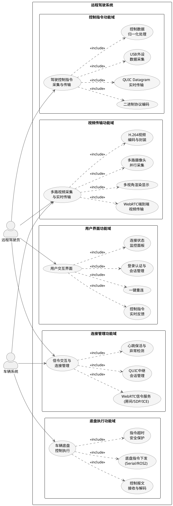
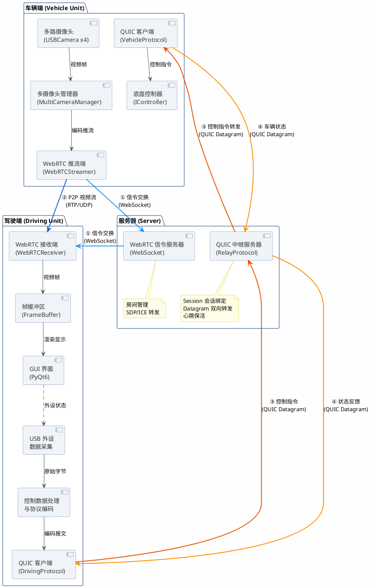
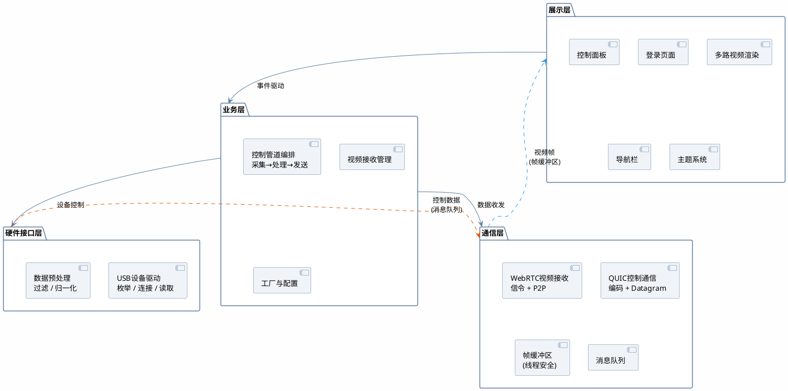
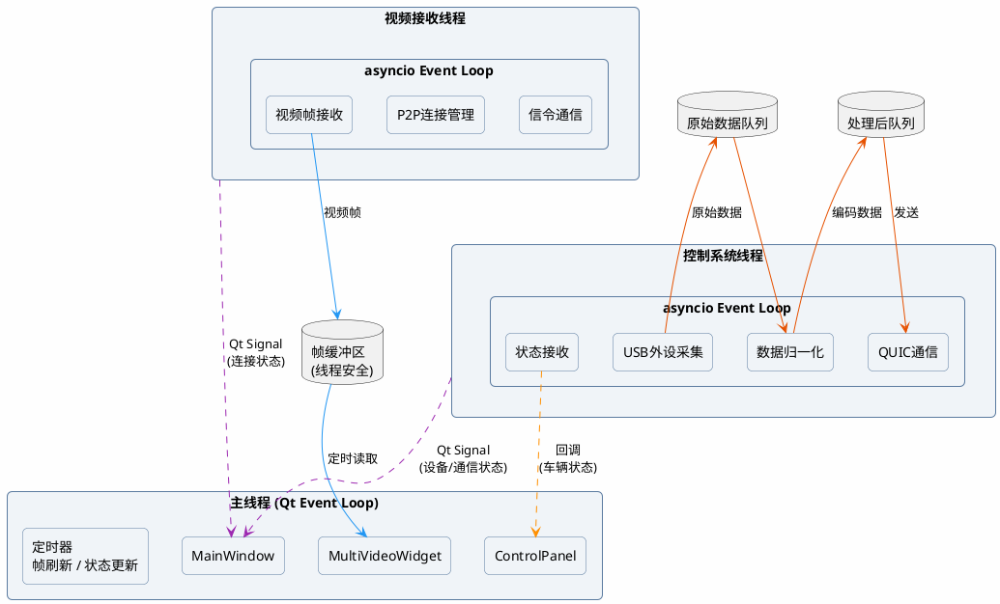
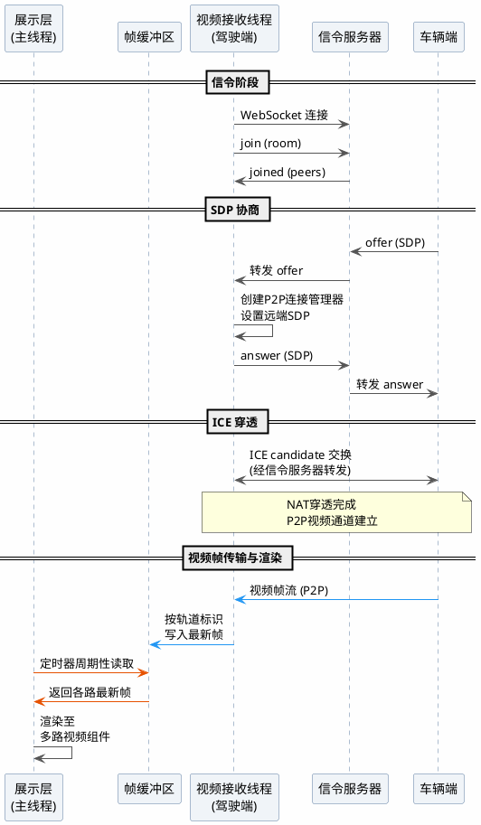
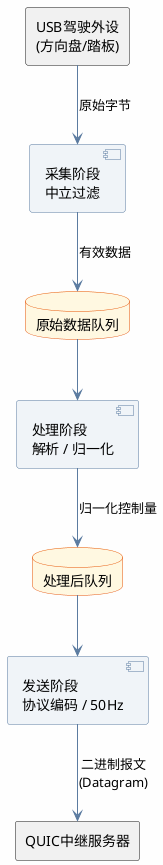
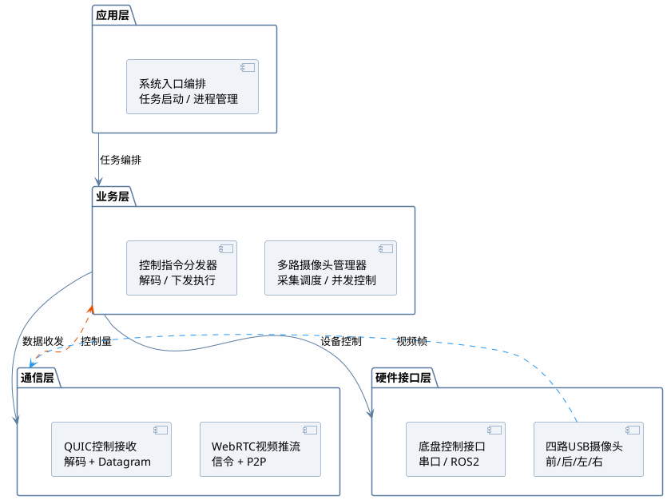
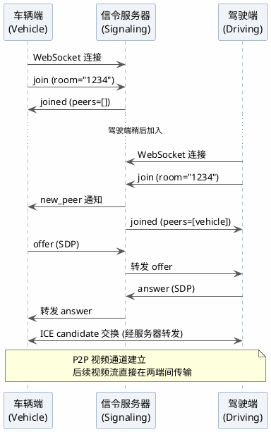
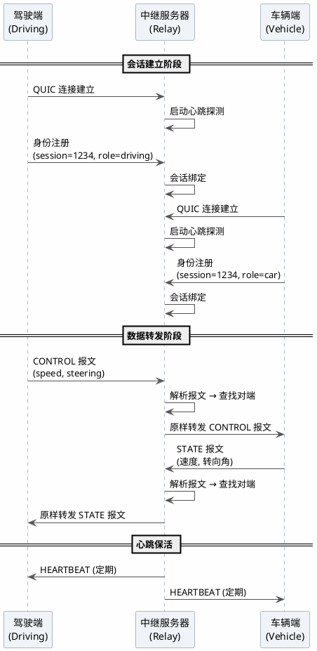

# 基于 WebRTC 与 QUIC 协议的远程驾驶系统设计与实现

## 摘要

（简要概述研究背景、研究目标、系统方案、核心技术及主要成果。约300字。）

关键词：远程驾驶；WebRTC；QUIC协议；低延迟视频传输；实时控制

## Abstract

（英文摘要，与中文摘要对应。）

Keywords: Remote Driving; WebRTC; QUIC Protocol; Low-latency Video Streaming; Real-time Control

---

## 1 绪论

### 1.1 研究背景与意义

（阐述远程驾驶技术在智能交通、无人配送、矿山作业等场景中的应用前景；分析当前自动驾驶技术的局限性，说明远程遥操作作为人机协同方案的必要性；指出低延迟音视频传输与可靠控制指令传输是远程驾驶系统的核心技术挑战。）

### 1.2 国内外研究现状

（综述远程驾驶/遥操作领域的研究进展，包括5G远程驾驶、基于WebRTC的远程监控系统、QUIC协议在实时通信中的应用等方向的代表性工作；分析现有方案在端到端延迟、传输可靠性、系统架构灵活性等方面的不足。）

### 1.3 研究内容与目标

（明确本文研究的四个核心内容：①系统总体架构设计；②基于WebRTC的低延迟多路视频传输方案；③基于QUIC Datagram的高可靠控制指令传输机制；④系统原型实现与性能评估。阐述系统的设计目标与性能指标要求。）

### 1.4 论文组织结构

（按章节简述论文的总体框架与各章的主要内容。）

---

## 2 相关技术与理论基础

### 2.1 WebRTC 技术

#### 2.1.1 WebRTC 体系结构与协议栈

（介绍WebRTC的整体架构，包括信令层、会话层与传输层的层次关系；阐述ICE、STUN、TURN等NAT穿透技术的工作机制。）

#### 2.1.2 SDP 协商与媒体能力交换

（详细说明SDP（Session Description Protocol）的结构与Offer/Answer协商模型，分析其在编解码器能力协商、传输参数配置中的作用。）

#### 2.1.3 媒体传输与拥塞控制

（分析WebRTC中基于RTP/RTCP的媒体数据传输机制，以及GCC（Google Congestion Control）等带宽估计与自适应码率调整算法。）

### 2.2 QUIC 协议

#### 2.2.1 QUIC 协议架构与特性

（介绍QUIC协议的设计目标与核心特性，包括基于UDP的传输层实现、0-RTT/1-RTT快速握手、内置TLS 1.3加密、多路复用与消除队头阻塞等关键机制。）

#### 2.2.2 QUIC Datagram 扩展

（阐述QUIC Datagram（RFC 9221）扩展的设计动机与语义，说明其相比可靠流传输在低延迟场景下的优势，分析其适用于高频控制信号传输的技术依据。）

### 2.3 H.264 视频编码标准

（概述H.264/AVC视频编码标准的核心技术，包括帧内/帧间预测、变换量化、熵编码等关键模块，分析其在实时视频传输场景中的编码效率与延迟特性。）

### 2.4 异步编程模型

（介绍Python asyncio异步编程框架的事件循环机制与协程调度模型，分析其在高并发I/O密集型网络应用中的性能优势。）

### 2.5 本章小结

---

## 3 需求分析

### 3.1 系统概述

本系统旨在构建一套面向远程驾驶场景的实时遥操作平台，使远程驾驶员能够在异地通过专业操控设备对目标车辆进行实时驾驶控制。系统的核心目标在于：以尽可能低的端到端延迟将车辆周围环境的多路视频画面传输至驾驶端，同时将驾驶员的操控指令高频、可靠地下发至车辆执行机构，从而形成"感知—决策—执行"的远程闭环控制回路。

在系统组成上，本系统采用"车辆端—服务器—驾驶端"的三层分布式架构。车辆端部署于实体车辆之上，承担环境感知与指令执行的职责，具体包括多路摄像头视频流的采集与编码推送，以及远程控制报文的接收、解析与底盘执行。服务器作为系统的中间枢纽，部署于云端或边缘节点，提供两类核心中介服务：其一为WebRTC信令服务，负责驾驶端与车辆端之间的视频连接协商与建立；其二为QUIC中继服务，负责控制指令的低延迟双向转发。驾驶端作为远程操控终端，承担视频接收渲染与操控指令采集发送的职责，同时提供图形化用户界面以支撑驾驶员的实时交互。

在数据通信上，系统设计了视频链路与控制链路两条独立的并行通道。视频链路基于WebRTC协议构建，车辆端通过多路摄像头采集周围环境视频，经H.264编码后以RTP媒体流的形式经由P2P或中继通道传输至驾驶端进行解码与渲染显示。控制链路基于QUIC协议构建，驾驶端通过USB外设（方向盘、踏板等）采集驾驶员的操控数据，经归一化处理与轻量级二进制协议编码后，以QUIC Datagram的形式经由中继服务器转发至车辆端，由底盘控制器解析执行。两条链路在传输层面相互独立、互不干扰，视频链路侧重高带宽与画面流畅性，控制链路侧重低延迟与高频实时性，二者协同构成完整的远程驾驶闭环。

系统的典型业务流程如下：首先，车辆端与驾驶端分别接入信令服务器与QUIC中继服务器，完成身份注册与连接建立；随后，车辆端开始推送多路视频流至驾驶端，驾驶员通过操控界面观察车辆周围环境并发出驾驶指令；指令经编码传输后由车辆端底盘执行，车辆的运动状态变化又实时反映在视频画面中，形成持续的感知—操控闭环。在整个过程中，系统通过心跳探测、自动重连、超时检测等机制持续监控各链路的健康状态，确保远程驾驶操作的连续性与安全性。

### 3.2 用户角色分析

在远程驾驶系统中，准确划分用户角色及其职责边界是需求分析的基础。根据系统的业务特征与交互模式，本系统涉及两类核心参与角色：远程驾驶员与车辆系统。前者作为人类操作主体，负责环境感知与驾驶决策；后者作为机器执行主体，负责指令执行与状态反馈。两类角色通过视频链路与控制链路构成闭环协作关系，各角色的职责定位与核心需求如表3-1所示。

**表3-1 系统角色职责对照表**

| 角色 | 类型 | 核心职责 | 系统交互方式 |
|------|------|---------|-------------|
| 远程驾驶员 | 人类操作者 | 环境感知、驾驶决策、操控指令下发 | USB外设输入、GUI视频监控 |
| 车辆系统 | 机器执行体 | 视频采集推送、指令解析执行、状态反馈 | 摄像头采集、串口/ROS2底盘控制 |

**（1）远程驾驶员**

远程驾驶员是本系统的核心人类操作用户，在远端通过专用驾驶控制终端对目标车辆实施实时遥操作。驾驶员通过图形化操控界面实时观察车辆端多路摄像头回传的周围环境视频画面，基于视觉感知进行驾驶决策，并通过标准化物理外设（方向盘、油门踏板、制动踏板）向车辆发送连续的驾驶控制指令。远程驾驶员在系统中同时扮演感知者与决策者的双重角色，其操控体验的实时性与直觉性直接决定远程驾驶的安全性与可靠性。

该角色对系统提出的核心需求如下：

（a）低延迟多路视频感知需求。驾驶员需要获取车辆周围环境的多视角视频画面，视频流应具备低端到端传输时延与高清晰度特性，以确保驾驶员能够准确感知车辆周围的交通状况与障碍物信息，支撑安全的驾驶决策。

（b）直觉式物理外设操控需求。系统应支持驾驶员通过标准驾驶外设（如方向盘、油门踏板、制动踏板等）进行操控，外设的操控量应被精确采集并以高频率传输至车辆端，确保操控响应的连续性与跟手感，使驾驶体验尽可能接近本地驾驶。

（c）链路状态感知与安全保障需求。在网络链路发生抖动或异常中断时，系统应向驾驶员提供实时的连接状态告警与反馈信息，使驾驶员能够及时感知通信异常并采取相应措施，必要时系统应具备触发紧急制动的安全保护机制。

**（2）车辆系统**

车辆系统是远程驾驶系统中的被控执行主体，部署于实体车辆之上，承担环境感知、指令执行与状态反馈三项核心功能。从系统角色的角度来看，车辆系统并非被动的终端设备，而是一个集成了多路视频采集与编码推流、控制报文接收与解析、底盘执行机构驱动等功能的自主运行节点，其在控制指令到达时负责忠实执行，在通信中断时则需具备独立的安全防护能力。

该角色对系统提出的核心需求如下：

（a）多路视频采集与实时推送需求。车辆系统需通过多路摄像头（本系统设计支持四路）对车辆周围环境进行全方位视频采集，并对原始视频数据进行编码压缩后实时推送至远端驾驶终端。视频推送过程应保证帧率稳定与画面流畅，以满足驾驶员对环境感知的实时性要求。

（b）控制指令高效解析与执行需求。车辆系统需以高频率接收远程下发的控制报文，对报文中包含的转向、加速、制动等控制量进行准确解析，并通过底盘控制接口（串口或ROS2）将指令下发至执行机构。指令执行的延迟应尽可能低，以确保车辆运动响应与驾驶员操控意图的一致性。

（c）自主安全防护需求。在网络彻底中断或控制指令超时等极端工况下，车辆系统必须在底层具备独立于远程控制链路的安全防护机制，能够自主触发紧急制动或安全停车操作，避免因通信故障导致车辆失控。

**（3）角色间协作关系**

在远程驾驶的业务流程中，远程驾驶员与车辆系统之间形成了典型的"感知—决策—执行"闭环协作关系。车辆系统作为感知前端，持续采集并推送环境视频至驾驶员；驾驶员基于视觉信息进行驾驶决策，将操控意图转化为控制指令回传至车辆系统；车辆系统执行指令后，其运动状态变化又实时反映在视频画面中。这一闭环中的信息流由视频链路（车辆→驾驶员，下行感知流）与控制链路（驾驶员→车辆，上行控制流）共同承载，两条链路的低延迟与高可靠性是保障闭环协作有效性的关键前提。

### 3.3 功能需求分析

基于前文对系统业务场景与用户角色的分析，本节从功能维度对系统的核心需求进行细化分解。根据远程驾驶闭环控制的数据流特征，系统的功能需求可划分为五个功能域：多路视频采集与实时传输、驾驶控制指令采集与传输、信令交互与连接管理、车辆底盘控制执行、以及用户交互界面。各功能域及其所属子功能的汇总如表3-2所示。

**表3-2 系统功能需求汇总表**

| 功能域 | 所属端 | 核心子功能 |
|-------|--------|-----------|
| 多路视频采集与实时传输 | 车辆端→驾驶端 | 多路摄像头并行采集、H.264编码推流、P2P视频传输、多视角渲染 |
| 驾驶控制指令采集与传输 | 驾驶端→车辆端 | USB外设数据采集、归一化处理、二进制编码、QUIC Datagram传输 |
| 信令交互与连接管理 | 服务器 | WebRTC信令交换、QUIC会话管理、心跳保活、异常检测 |
| 车辆底盘控制执行 | 车辆端 | 控制报文解码、底盘指令下发、多接口适配 |
| 用户交互界面 | 驾驶端 | 登录认证、多路视频显示、状态监控、指令反馈 |

系统的功能用例关系如图3-1所示。图中以远程驾驶员与车辆系统为参与者（Actor），以五大功能域为核心用例，展示了各功能用例之间的包含（include）与关联关系。

**图3-1 系统功能用例图**



#### 3.3.1 多路视频采集与实时传输

多路视频采集与实时传输是远程驾驶系统的感知基础，其功能目标在于将车辆周围环境的多视角视频画面以尽可能低的延迟传输至驾驶端，为驾驶员提供直观、全面的环境感知信息。该功能域涵盖从视频信号采集到远端画面渲染的完整数据流路径，具体功能需求如下：

（a）多路摄像头并行采集。系统应支持至少四路USB摄像头的并行视频采集，分别覆盖车辆前方、后方、左侧与右侧的环境视野。每路摄像头应支持可配置的采集分辨率与帧率参数，各路采集过程应相互独立，单路摄像头的异常不应影响其他路视频的正常采集与传输。

（b）视频编码与流封装。采集到的原始视频帧应经过H.264编码压缩，以降低传输带宽需求。编码后的视频数据需封装为符合WebRTC规范的媒体流格式，每路摄像头对应一条独立的视频轨（VideoTrack），以支持驾驶端对不同视角的独立识别与渲染。

（c）基于WebRTC的端到端视频传输。视频流的传输应基于WebRTC协议栈实现，优先通过ICE框架建立点对点（P2P）的UDP直连通道。在复杂网络环境导致P2P建连失败时，系统应能自动回退至TURN中继模式，保障视频传输的连通性。传输过程中应支持基于带宽估计的自适应码率调整，在网络带宽受限时动态降低编码码率或帧率，维持视频流的流畅性。

（d）驾驶端多视角渲染显示。驾驶端应能够同时接收并解码多路视频流，将各路视频画面以网格化布局渲染于操控界面中。系统应支持以前方视角为主视图、其余视角为辅助视图的布局模式，各视角画面应实时更新帧率与分辨率统计信息，便于驾驶员与系统运维人员监控视频质量。

#### 3.3.2 驾驶控制指令采集与传输

驾驶控制指令的采集与传输是远程驾驶闭环控制的上行控制链路，其功能目标在于将驾驶员的物理操控动作精确、高频地转化为数字控制信号并传输至车辆端。该功能域涉及从外设物理量采集到网络报文发送的完整数据处理管道，具体功能需求如下：

（a）USB驾驶外设数据采集。系统应支持通过USB接口接入标准驾驶外设（方向盘、油门踏板、制动踏板等），能够自动枚举并识别指定厂商标识（Vendor ID）与产品标识（Product ID）的USB HID设备，通过批量传输（Bulk Transfer）方式持续读取外设输出的原始控制数据。采集过程应具备中立状态过滤能力，在外设处于静止中位时不产生冗余数据，降低后级处理与传输的负荷。

（b）控制数据归一化处理。系统应将外设输出的原始字节数据解析为转向角度、油门开度、制动力度等语义化控制量，并将各控制量归一化至统一的浮点数值区间（如[-1.0, +1.0]），以屏蔽不同外设硬件之间的数据格式差异，为上层传输协议提供标准化的控制数据接口。

（c）轻量级控制协议编码。归一化后的控制数据应按照自定义的二进制控制协议进行紧凑编码。协议报文应包含消息类型标识、会话标识、速度控制量与转向控制量等核心字段，各字段采用定长的无符号整数编码（如uint8、uint16），以最小化单帧报文的字节长度，提升传输效率。

（d）基于QUIC Datagram的实时传输。编码后的控制报文应通过QUIC Datagram机制进行传输。QUIC Datagram相比传统可靠流传输，不引入队头阻塞与重传等待，适用于高频、低延迟的控制信号传输场景。系统应保证控制指令的发送频率不低于50Hz，以满足远程驾驶对操控实时性的要求。传输过程中应支持断线自动重连，确保控制链路的持续可用性。

#### 3.3.3 信令交互与连接管理

信令交互与连接管理是系统各端之间建立通信通道的前置基础，其功能目标在于通过中心化的服务器实现驾驶端与车辆端之间的节点发现、通道协商与会话维护。本系统涉及两类信令服务：面向视频链路的WebRTC信令服务，以及面向控制链路的QUIC中继会话管理服务。

（a）WebRTC信令服务。系统应提供基于WebSocket的信令服务器，支撑WebRTC视频连接的协商与建立。信令服务应实现以下核心功能：基于房间（Room）机制的逻辑隔离，使不同驾驶会话之间的信令互不干扰；驾驶端与车辆端通过加入同一房间实现节点发现；在房间内转发SDP Offer/Answer消息，完成双端的媒体编解码能力协商；转发ICE Candidate消息，辅助双端完成NAT穿透与最优传输路径选择。此外，信令服务应具备完整的生命周期管理能力，包括节点上线/离线检测、房间满员控制以及僵尸连接的自动清理。

（b）QUIC中继会话管理服务。系统应提供基于QUIC协议的中继服务器，负责控制指令在驾驶端与车辆端之间的双向转发。中继服务应实现以下核心功能：驾驶端与车辆端在接入时分别发送身份注册报文（HELLO_DRIVING / HELLO_CAR），携带会话标识（Session ID），由服务器完成会话绑定；服务器根据会话绑定关系，将一端发送的控制报文或状态数据透传至对端；双端应周期性发送心跳（Heartbeat）报文，服务器据此维持连接活性并检测链路可用性；在连接异常断开时，服务器应自动清理对应的会话绑定关系，释放系统资源。

#### 3.3.4 车辆底盘控制执行

车辆底盘控制执行是远程驾驶闭环的末端执行环节，其功能目标在于将接收到的远程控制报文准确转化为车辆底盘的物理运动。该功能域位于车辆端的最底层，直接与车辆执行机构交互，具体功能需求如下：

（a）控制报文接收与解码。车辆端应通过QUIC连接持续接收中继服务器转发的控制报文，并使用与驾驶端一致的二进制控制协议进行解码，从报文中提取转向角度、速度等归一化控制量。解码过程应具备报文合法性校验能力，对格式异常或长度不匹配的报文予以丢弃并记录告警日志。

（b）底盘控制指令下发。解码后的控制量应通过底盘控制接口下发至车辆执行机构。系统应提供统一的控制器抽象接口（IController），支持多种底盘通信方式的适配。当前系统应至少支持两种实现方式：基于串口（Serial）协议的直接底盘控制，以及基于ROS2 cmd_vel话题的速度指令发布。控制器的切换应通过配置驱动，无需修改上层业务逻辑。

（c）指令超时安全保护。车辆端应对控制指令的接收间隔进行监控，若在预设的超时周期内未收到有效控制报文，应视为通信链路异常，自动触发安全制动操作，将车辆减速至停止状态，防止因通信中断导致车辆在无人控制下持续运动。

#### 3.3.5 用户交互界面

用户交互界面是驾驶员与远程驾驶系统交互的唯一前端入口，其功能目标在于为驾驶员提供直观、高效的操控环境，整合视频监控、状态感知与操控反馈等信息于统一的图形化界面中。具体功能需求如下：

（a）登录认证与会话管理。系统应提供登录界面，支持驾驶员输入会话标识（Session ID）与房间号（Room）进行身份认证与会话绑定。登录成功后系统自动切换至主控制界面并启动后台通信服务；系统应支持退出登录操作，退出时应安全停止所有后台线程与网络连接，释放系统资源后返回登录页面。

（b）多路视频实时渲染。主控制界面的核心区域应以网格化布局同时渲染多路视频画面（前方、后方、左侧、右侧），各路视频应独立解码与渲染，支持实时帧率统计与分辨率显示。视频渲染应由独立的定时器驱动刷新，刷新频率不低于30Hz，确保画面更新的流畅性。在视频信号尚未到达或传输中断时，相应视频区域应显示明确的状态提示信息。

（c）连接状态监控面板。界面应设置独立的状态监控面板，实时显示系统各关键链路的连接状态，至少应包括：WebSocket信令连接状态、WebRTC视频连接状态、视频流传输状态、USB外设连接状态、QUIC控制链路连接状态。各状态项应以在线/离线的视觉标识直观呈现，并附带详细的状态描述文本（如"在线"、"连接中"、"等待车端"、"错误"等），使驾驶员能够快速定位通信异常环节。

（d）控制指令实时反馈。界面应实时显示当前发送至车辆端的控制指令数值（包括速度、转向角度等），以及从车辆端回传的实际运动状态数据与往返时延（RTT），便于驾驶员确认指令是否被正确执行，同时为系统调试与性能分析提供可视化支撑。

（e）一键重连功能。当通信链路发生异常中断时，界面应提供一键重连功能，允许驾驶员在不退出登录的情况下重新初始化视频接收线程与控制通信线程，快速恢复远程驾驶会话。

### 3.4 非功能需求分析

功能需求定义了系统"做什么"，非功能需求则约束了系统"做得多好"。远程驾驶系统的特殊性在于其直接涉及车辆运动控制与行车安全，因此在实时性、可靠性、安全性与可扩展性等维度上具有严格的质量约束。本节对上述四类非功能需求进行分析与定义。

#### 3.4.1 实时性需求

实时性是远程驾驶系统最为核心的非功能需求。端到端延迟直接影响驾驶员的操控响应能力——延迟过高将导致驾驶员对车辆运动状态的感知滞后，进而引发操控偏差甚至安全事故。系统的实时性需求主要体现在以下两个维度：

（a）视频传输端到端延迟。视频传输的端到端延迟定义为从车辆端摄像头采集一帧图像到该帧在驾驶端屏幕上完成渲染显示的时间间隔。该延迟链路涵盖图像采集、编码压缩、网络传输、解码还原与渲染显示五个阶段。考虑到远程驾驶场景中驾驶员需要基于视频画面进行实时决策与操控，系统的视频端到端延迟应控制在200ms以内，当延迟超过300ms时驾驶员将明显感知到操控滞后，安全性将显著下降。同时，视频帧率应不低于20fps，以保证画面的连续性与流畅性。

（b）控制指令传输延迟。控制指令的传输延迟定义为从驾驶端外设产生一次操控动作到车辆端底盘执行机构开始响应的时间间隔。该延迟链路涵盖USB数据读取、数据处理与编码、网络传输（经中继服务器转发）与报文解码执行四个阶段。为满足远程驾驶对操控响应的实时性要求，控制指令的单程传输延迟应控制在100ms以内。此外，控制指令的发送频率应不低于50Hz（即20ms发送间隔），以保证控制信号的连续性，避免因采样频率不足导致车辆运动出现离散化的阶梯效应。

#### 3.4.2 可靠性需求

远程驾驶系统在实际运行过程中面临网络波动、设备异常、进程崩溃等多种不确定因素，系统必须具备充分的容错能力与自恢复机制，以保障远程驾驶会话的连续性与安全性。具体可靠性需求如下：

（a）网络链路自动重连。视频链路（WebRTC）与控制链路（QUIC）在发生连接断开时，客户端应自动进入重连循环，以固定的退避间隔（如3秒）周期性尝试重新建立连接，直至连接恢复成功。重连过程不应导致应用程序崩溃或资源泄漏，已有的会话上下文应在重连后自动恢复。

（b）心跳探测与连接活性检测。QUIC中继服务器与各客户端之间应建立周期性心跳机制（如每5秒发送一次心跳报文），用于检测连接的活性状态。当服务器在连续多个心跳周期内未收到某端的心跳响应时，应判定该连接已失效，主动清理对应的会话绑定关系并释放资源，防止僵尸连接的积累。

（c）USB外设热插拔容错。驾驶端应具备对USB驾驶外设热插拔的容错能力。当外设在运行过程中被意外断开时，系统应及时检测到设备离线状态并通过界面告警通知驾驶员，而非直接崩溃；当外设重新接入时，系统应自动恢复数据采集，无需手动重启应用。

（d）安全制动保护。作为最后一道安全防线，车辆端应对控制指令的接收间隔进行持续监控。若在预设的超时窗口内未收到任何有效控制报文，车辆端应自动启动安全制动程序，将车辆平稳减速至停止状态，确保在通信彻底中断的极端情况下车辆不会处于无人控制的失控运动状态。

#### 3.4.3 安全性需求

远程驾驶系统的数据传输涉及车辆控制指令与实时视频流，一旦传输链路被窃听或中间人篡改，将直接威胁行车安全。因此，系统的所有通信链路均应具备加密保护能力，具体安全性需求如下：

（a）控制链路加密。QUIC协议在传输层内置了TLS 1.3加密机制，所有通过QUIC通道传输的控制报文与心跳消息均自动处于加密保护之下，无需在应用层额外实现加密逻辑。QUIC中继服务器应强制配置TLS证书（cert.pem与key.pem），拒绝未加密的明文连接请求。

（b）视频链路加密。WebRTC协议栈在媒体传输层采用DTLS-SRTP机制，对RTP视频流进行端到端加密。信令通道（WebSocket）传输的SDP与ICE信息虽不包含视频内容本身，但涉及连接协商参数，在生产环境中亦应通过WSS（WebSocket Secure）进行加密传输。

（c）身份认证与会话隔离。系统应通过Session ID实现驾驶会话的逻辑隔离，不同会话的控制报文与视频流不应发生交叉路由。信令服务器的房间机制与QUIC中继服务器的会话绑定机制共同保障了多会话场景下的数据隔离性。

#### 3.4.4 可扩展性需求

为适应未来业务场景的演进（如多车编队远程控制、不同车型底盘适配等），系统架构应在以下维度上具备可扩展性：

（a）底盘控制接口可扩展。车辆端的底盘控制应通过统一的抽象接口（IController）进行解耦，使得上层业务逻辑与底层硬件通信方式无关。当需要支持新型底盘（如CAN总线控制、线控底盘协议等）时，仅需实现新的IController子类并通过配置注入，无需修改控制链路的核心逻辑。

（b）视频采集源可扩展。车辆端的摄像头采集应通过统一的抽象接口（ICamera）进行解耦，支持USB摄像头、网络摄像头（RTSP）、仿真测试摄像头等多种视频源的灵活接入。新增视频源类型时仅需实现对应的ICamera子类，不影响推流与管理模块的代码。

（c）多车并发会话支持。服务器端的会话管理机制应支持多组驾驶端与车辆端同时在线并独立工作。信令服务器通过房间隔离机制、QUIC中继服务器通过Session ID绑定机制，实现了天然的多会话并行支持能力。系统架构在设计上不应存在单会话的硬编码限制。

（d）模块间松耦合架构。系统各端的内部架构应遵循依赖倒置原则，通过接口层（interfaces）定义各模块之间的交互契约，基础设施层（infrastructure）提供具体实现，应用层（app/application）编排业务流程。这种分层解耦的架构使得各模块可以独立演进、替换与测试，降低系统的维护成本与技术债务。

### 3.5 本章小结

---

## 4 系统设计

### 4.1 系统总体架构设计

#### 4.1.1 架构设计思路

基于第3章的需求分析，本系统的架构设计面临以下核心挑战：一是视频数据与控制指令在传输特征上存在根本性差异——视频流具有高带宽、容忍少量丢帧的特点，而控制指令具有低带宽、极高实时性与频率要求的特点；二是驾驶端与车辆端通常部署于不同的网络环境中，需要借助服务器实现跨网络的连接协商与数据中继；三是系统应具备良好的模块化与可扩展性，以适应多种车型底盘与外设硬件的接入需求。

针对上述挑战，本系统采用 **"车辆端—服务器—驾驶端"三层分布式架构**，并在通信层面设计了 **视频链路与控制链路双通道并行** 的传输方案。三层架构将系统的功能职责在物理部署维度上进行清晰分离：车辆端负责环境感知与指令执行，服务器负责连接协商与数据中继，驾驶端负责视频呈现与操控指令采集。双通道并行方案则将视频传输与控制传输解耦至两条独立的通信链路上，使得两类数据流在协议选型、传输策略与故障处理上可以独立优化，互不干扰。

#### 4.1.2 双通道架构决策依据

视频链路选用WebRTC协议构建，主要基于以下考量：WebRTC协议栈内置了完整的媒体采集、编码、传输与解码能力，支持基于ICE框架的NAT穿透与P2P直连，能够在网络条件允许时避免服务器中转，最大限度降低视频传输延迟；同时WebRTC内置的GCC拥塞控制算法可根据网络带宽动态调整编码码率，在带宽受限时自动降级以维持视频流的流畅性。

控制链路选用QUIC协议构建，主要基于以下考量：控制指令具有高频（50Hz）、低负载（单帧报文仅数字节）、强实时性的传输特征，传统TCP协议的可靠传输机制（重传、队头阻塞）会引入不可接受的延迟抖动。QUIC Datagram扩展（RFC 9221）提供了基于UDP的不可靠数据报传输语义，既继承了QUIC协议的快速握手（0-RTT/1-RTT）与内置TLS 1.3加密优势，又避免了可靠传输的队头阻塞问题，非常适合高频控制信号的实时传输场景。

两条链路在逻辑上完全独立：视频链路的连接建立、媒体传输与异常恢复不依赖控制链路；控制链路的会话管理、指令传输与心跳保活亦不依赖视频链路。这种解耦设计确保了单条链路的故障不会导致整个系统失效——例如视频链路短暂中断时，控制链路仍可继续传输指令维持车辆安全运行。

#### 4.1.3 系统总体架构图

系统的总体架构如图4-1所示。图中展示了三层节点的内部组件构成、两条通信链路的传输路径，以及各组件之间的数据流方向。

**图4-1 系统总体架构图**



#### 4.1.4 数据流分析

如图4-1所示，系统中存在两条主要的数据流路径：

**（1）下行感知流（视频链路）。** 车辆端多路USB摄像头持续采集环境视频帧，经MultiCameraManager统一管理后，由WebRTCStreamer编码封装为多条VideoTrack并推送。推流前，车辆端与驾驶端通过WebSocket信令服务器完成SDP/ICE交换（图中路径①），协商成功后建立P2P的UDP直连通道（图中路径②），视频流以RTP协议直接在两端之间传输，不经过服务器中转。驾驶端的WebRTCReceiver接收并解码视频帧，存入FrameBuffer，由GUI定时器驱动渲染至多视角显示界面。

**（2）上行控制流（控制链路）。** 驾驶端USB外设采集驾驶员的操控数据，经数据处理模块归一化与协议编码后，由DrivingProtocol以QUIC Datagram的形式发送至QUIC中继服务器（图中路径③）。中继服务器根据Session ID查询会话绑定关系，将控制报文透传至对应的车辆端VehicleProtocol。车辆端解码后通过IController接口将指令下发至底盘执行。同时，车辆端可将实时运动状态（速度、转向角等）封装为STATE报文经中继服务器回传至驾驶端（图中路径④），实现双向状态反馈。

两条数据流在传输层面完全独立，在应用层面通过"视频反映操控结果"形成逻辑闭环，共同支撑远程驾驶的实时交互。

### 4.2 驾驶端设计

#### 4.2.1 驾驶端整体架构

驾驶端作为远程驾驶系统的操控前端，内部功能涵盖USB外设数据采集、网络通信、业务逻辑编排与图形化用户界面等多个职责域。为实现各职责域之间的松耦合与独立演进，驾驶端按数据流向自底向上划分为四层架构，各层的职责如下：

（a）硬件接口层。负责与物理驾驶外设（USB方向盘、油门踏板、制动踏板等）的底层交互。该层封装USB设备的枚举、连接建立、原始数据读取与断线重连等硬件操作，向上层提供统一的输入设备抽象接口，屏蔽不同USB设备的硬件差异。同时负责对原始控制数据的预处理，包括中立状态过滤与控制量归一化。

（b）通信层。负责驾驶端与外部服务器之间的所有网络通信，包括两条独立的通信链路：WebRTC视频接收链路（基于WebSocket的信令交换与基于aiortc的P2P视频帧接收）和QUIC控制发送链路（基于aioquic的Datagram控制报文发送与车辆状态接收）。通信层封装信令协议、编解码协议与连接管理逻辑，向上层提供"发送控制指令"与"接收视频帧"的高层语义接口。

（c）业务层。编排驾驶端的核心业务流程，协调硬件接口层与通信层完成端到端的数据处理。业务层的核心职责包括：管理控制数据从USB采集到QUIC发送的完整处理管道（生产者—消费者模式）、协调WebRTC视频接收的生命周期管理、处理自动重连与异常恢复策略。业务层通过工厂模式与配置管理屏蔽组件实例化的细节。

（d）展示层。基于PyQt6构建图形化用户界面，包括登录页面、多路视频渲染、控制面板与导航栏等组件以及主题样式系统。展示层仅负责数据的可视化呈现与用户交互事件的采集，通过定时器机制从帧缓冲区读取视频帧进行渲染，不包含业务逻辑。

驾驶端的分层架构如图4-2所示。

**图4-2 驾驶端分层架构图**



#### 4.2.2 多线程异步处理架构

驾驶端需要同时处理GUI事件响应、多路视频帧渲染、USB外设数据轮询、控制数据处理与QUIC网络通信等多项并发任务。这些任务在执行特征上存在显著差异：GUI渲染与用户交互属于事件驱动型任务，必须在主线程的Qt事件循环中执行；视频接收与控制通信属于I/O密集型的长期运行任务，适合在独立线程中以异步协程方式执行。

基于上述分析，驾驶端设计了"一主两工"的多线程并发处理架构：

**（1）主线程。** 运行PyQt6的事件循环，负责GUI界面的事件处理与视频帧渲染。主线程通过定时器机制驱动周期性的帧刷新与状态更新任务，不执行任何阻塞性I/O操作，确保界面响应的流畅性。

**（2）视频接收线程。** 运行独立的异步事件循环，承载WebRTC视频接收的全部异步逻辑，包括信令通信、SDP/ICE交换、P2P连接管理与视频帧接收。接收到的视频帧通过线程安全的帧缓冲区传递至主线程进行渲染。

**（3）控制系统线程。** 运行独立的异步事件循环，并发调度USB外设数据采集、控制数据归一化处理、QUIC控制报文发送与车辆状态接收四项协程任务。各协程通过异步消息队列串联，形成完整的数据处理管道。

三个线程之间通过两种机制进行跨线程通信：视频帧数据通过线程安全的帧缓冲区传递；连接状态变化通过Qt信号机制从工作线程通知至主线程。系统退出时，通过停止标志触发各协程的优雅退出，主线程阻塞等待工作线程终止，确保所有网络连接被正确关闭。

驾驶端的多线程架构如图4-3所示。

**图4-3 驾驶端多线程架构图**



#### 4.2.3 WebRTC 视频接收模块设计

WebRTC视频接收模块负责驾驶端与车辆端之间视频通道的建立与媒体数据的接收，其内部由三个核心组件协作完成：

**（1）信令客户端。** 负责与WebRTC信令服务器之间的WebSocket长连接通信，完成房间加入与信令消息的收发分发。采用消息类型驱动的分发模式，将接收到的信令消息路由至对应的处理逻辑。

**（2）P2P连接管理器。** 封装单个WebRTC P2P连接的完整生命周期管理，包括ICE服务器配置、SDP协商、ICE候选交换与媒体轨道接收。系统通过连接管理器的多实例管理机制（以Peer标识为索引）支持多Peer场景。

**（3）帧缓冲区。** 作为视频接收线程与主线程之间的数据桥梁，按视频轨道标识分区存储帧数据，每路视频仅保留最新一帧，主线程的渲染定时器周期性读取各路最新帧进行显示。这种设计避免了帧队列的无限增长，同时确保主线程始终渲染最新画面。

驾驶端视频接收的端到端交互流程如图4-x所示。

**图4-x 驾驶端视频接收端到端时序图**



#### 4.2.4 控制指令处理链路设计

控制指令处理链路采用生产者—消费者管道模式，将USB数据采集、数据处理与网络发送三个阶段通过异步消息队列解耦为独立的协程任务。各阶段的设计如下：

**（1）采集阶段（生产者）。** 通过USB设备驱动与外设建立连接，持续读取驾驶员操控的原始数据包。读取到的数据经中立状态过滤（过滤方向盘与踏板处于中位的静止数据）后放入原始数据队列。USB连接断开时自动进入重连循环。

**（2）处理阶段。** 从原始数据队列中取出字节数据，解析提取转向角度、油门开度、制动力度等语义化控制量，将各控制量归一化至[-1.0, +1.0]的浮点区间后放入处理后队列。

**（3）发送阶段（消费者）。** 从处理后队列中取出控制数据，经二进制协议编码后以QUIC Datagram形式发送至中继服务器，维持50Hz的发送频率。若队列在超时时间内无新数据则跳过本轮发送，避免重发过期指令。

三个阶段的处理速率互不约束，队列起到缓冲与解耦的作用，使得各阶段可以以各自的最优节奏独立运行。控制指令处理链路的数据流如图4-x所示。

**图4-x 控制指令处理链路数据流图**



#### 4.2.5 用户界面设计

驾驶端的图形化用户界面基于PyQt6框架构建，采用工厂模式统一管理组件的实例化与主题样式注入。界面设计的核心方案如下：

**（1）页面管理机制。** 系统采用页面栈机制实现登录页面与主控制页面的切换。应用启动时展示登录页面，驾驶员输入会话标识与房间号后触发切换至控制页面，同时初始化后台通信服务；退出登录时安全停止所有后台任务后切回登录页面，完成会话的完整生命周期管理。

**（2）多路视频渲染。** 控制页面以2×2网格布局同时渲染前方、后方、左侧、右侧四路视频画面，每路视频由独立的显示子组件负责渲染，主线程定时器驱动帧刷新。

**（3）控制面板。** 位于视频区域右侧，展示五项连接状态指示（信令、视频连接、视频流、USB外设、QUIC控制）、四路摄像头的帧率与分辨率统计、以及当前控制指令数值与往返时延。

**（4）主题系统。** 通过全局主题对象统一管理背景色、文本色、字体等样式参数，所有UI组件通过主题对象获取样式，为未来的主题切换预留扩展空间。

### 4.3 车辆端设计

#### 4.3.1 车辆端整体架构

车辆端部署于实体车辆之上，承担视频采集推流与控制指令接收执行两项核心职责。车辆端按数据流向自底向上划分为四层架构，各层的职责如下：

（a）硬件接口层。负责与车辆物理设备的底层交互，包括两类硬件资源：四路USB摄像头（前方、后方、左侧、右侧）提供多视角视频采集能力，通过摄像头驱动完成设备初始化、帧率/分辨率配置与视频帧读取；底盘控制接口通过串口或ROS2话题与车辆执行机构通信，将接收到的控制量转化为车辆的实际运动。硬件接口层通过ICamera与IController抽象接口屏蔽不同硬件设备的差异，支持USB摄像头与测试摄像头、串口控制器与ROS2控制器的灵活切换。

（b）通信层。负责车辆端与外部网络的所有通信，包括两条链路：WebRTC视频推流链路（通过信令客户端完成SDP/ICE交换，建立P2P连接后将视频帧编码推送至驾驶端）和QUIC控制接收链路（通过QUIC Datagram接收驾驶端发送的控制报文，并解码提取控制量）。通信层封装信令协议、报文编解码与连接管理逻辑。

（c）业务层。编排车辆端的核心业务流程，包括两个关键组件：多路摄像头管理器负责协调四路摄像头的并行采集与推流调度，通过帧计数器增量检测、信号量并发控制与独立帧率管理等策略实现高效的多路视频推流；控制指令分发器负责将通信层解码后的控制量通过IController接口下发至硬件接口层的底盘控制器。

（d）应用层。作为车辆端的顶层入口，负责系统启动编排与进程管理。应用层并发启动视频推流任务与控制指令接收任务，管理各任务的生命周期与异常恢复。

车辆端的分层架构如图4-4所示。

**图4-4 车辆端分层架构图**



#### 4.3.2 多路摄像头采集与管理设计

多路摄像头采集与管理是车辆端视频功能的核心模块，由多路摄像头管理器统一协调。其设计方案包含以下关键策略：

**（1）并行启动与预热机制。** 管理器在启动时并行初始化所有已注册的摄像头采集任务，全部启动完成后统一进行预热等待，使摄像头的自动曝光与缓冲达到稳定状态后再开始推流。

**（2）基于帧计数器的增量推送策略。** 每路摄像头内部维护一个帧计数器，管理器通过对比帧计数器的变化判断是否有新帧到达：有新帧时获取最新帧并更新缓存，无新帧时复用上一帧推送。初始阶段使用黑帧作为占位，确保推流不中断。这种增量检测策略避免了对帧数据的无效重复拷贝。

**（3）并发编码数量控制。** 当系统同时运行四路摄像头时，通过信号量机制限制同一时刻的并行编码路数（默认为2），有效平滑CPU负载峰值，在保证视频流畅性的同时避免系统过载。

**（4）独立帧率控制。** 每路推流任务在完成一次推送后按目标帧率进行休眠，保证视频轨的帧率稳定性。

#### 4.3.3 WebRTC 视频推流模块设计

WebRTC视频推流模块负责将车辆端采集的多路视频帧通过WebRTC协议推送至驾驶端，其核心设计包含以下层次：

**（1）视频轨管理。** 系统为每路摄像头注册一个以摄像头名称标识的自定义视频轨，驾驶端可据此区分不同视角的视频流。视频轨内部维护最新帧缓存，由摄像头管理器更新帧数据，WebRTC底层在需要时自动拉取最新帧进行编码推送。

**（2）推流器。** 整合信令客户端与视频轨管理器，实现完整的Offer/Answer推流流程：当新的驾驶端Peer加入时，推流器为其创建P2P连接并添加所有视频轨，完成SDP协商与ICE候选交换后建立视频通道。推流器通过多连接管理支持同一车辆端向多个驾驶端并行推送视频流。

#### 4.3.4 控制指令接收与执行设计

控制指令接收与执行模块负责车辆端从QUIC中继服务器接收远程控制报文并驱动底盘执行机构，其核心设计如下：

**（1）QUIC控制客户端。** 负责与中继服务器的QUIC连接管理，连接建立后发送身份注册报文完成会话绑定。内置自动重连机制，连接异常断开时持续尝试重新建立连接。

**（2）协议处理器。** 持续监听QUIC Datagram事件，将接收到的控制报文解码后提取运动控制量，通过底盘控制器抽象接口下发至执行机构。同时支持向驾驶端回传车辆运动状态，用于状态监控与RTT计算。

**（3）底盘控制器接口与多实现。** 车辆端通过IController抽象接口对底盘控制逻辑进行解耦，当前系统提供两种实现：串口控制器（适用于直连底盘控制板的场景）与ROS2控制器（适用于基于ROS2的车辆平台）。上层协议处理器无需感知底层控制方式，控制器的选择通过配置驱动，实现了底盘控制逻辑与通信协议的彻底解耦。

### 4.4 服务器端设计

服务器端作为系统三层架构的中间枢纽，部署于云端或边缘节点，提供两类独立的中介服务：面向视频链路的WebRTC信令服务器与面向控制链路的QUIC中继服务器。两个服务在进程级别相互独立，分别监听不同的端口，可根据负载情况灵活部署于同一主机或不同主机。

#### 4.4.1 WebRTC 信令服务器设计

WebRTC信令服务器的核心职责是为驾驶端与车辆端之间的WebRTC视频连接提供信令交换通道。由于WebRTC协议本身不定义信令传输方式，本系统基于WebSocket协议自建轻量级信令服务器，其设计包含以下组件：

**（1）信令服务器。** 基于异步WebSocket协议实现，负责端口监听、连接接入与请求分发。每当有新客户端接入时，服务器为其创建对等端对象并注册至房间管理器，随后将收到的消息交由房间管理器进行业务处理。服务器通过配置文件管理心跳间隔、最大消息大小、房间容量等运行参数，并支持优雅退出机制。

**（2）房间管理器。** 信令服务器的业务逻辑核心，负责房间的创建与销毁、对等端的加入与离开、以及信令消息的路由。其关键设计如下：

- **房间机制。** 每个房间管理其内部的对等端集合，支持最大人数上限控制（默认为2，即一个驾驶端对应一个车辆端）。新客户端加入时，房间向已有对等端广播通知，同时向新加入者返回已有对等端列表。对等端离开时广播通知，空房间自动销毁。

- **消息路由。** 基于消息类型进行路由分发：join消息触发房间加入流程；offer、answer、candidate等信令消息触发转发流程。转发支持定向发送（指定目标对等端）与房间内广播两种模式，所有转发消息自动标记发送者身份。

信令服务器的完整交互时序如图4-5所示。

**图4-5 WebRTC信令交互时序图**



#### 4.4.2 QUIC 中继服务器设计

QUIC中继服务器的核心职责是为驾驶端与车辆端之间的控制指令传输提供低延迟的双向转发通道。与WebRTC的P2P模式不同，控制链路始终经由中继服务器转发，这一设计决策基于两个考量：一是控制报文的数据量极小（单帧仅数字节），中继转发不会成为带宽瓶颈；二是中继模式可避免NAT穿透的不确定性，保障控制链路的连接可靠性。中继服务器的核心设计如下：

**（1）中继协议处理器。** 负责每个QUIC连接的事件处理，根据接收到的报文类型进行分类处理：

- **身份注册消息：** 客户端发送身份注册报文，中继服务器将该连接与对应的会话和角色进行绑定。

- **数据转发消息：** 中继服务器根据发送方角色查找同一会话下对端的连接，将原始报文原封不动地转发。若对端尚未注册则丢弃。

- **心跳消息：** 维持连接活性状态。

**（2）会话管理器。** 管理驾驶端与车辆端之间的会话绑定关系，是中继服务器的路由核心。基于会话标识与角色的二维索引结构，支持快速查找对端连接。连接断开时自动清理绑定关系，空会话自动销毁。会话管理器以全局单例模式运行，所有协议处理器共享。

**（3）心跳探测机制。** 每个连接建立时自动启动心跳探测任务，定期向客户端发送心跳报文以主动检测连接可用性。若发送失败则判定连接失效，清理会话绑定。

QUIC中继服务器的报文转发流程如图4-6所示。

**图4-6 QUIC中继服务器报文转发流程图**



### 4.5 通信协议设计

#### 4.5.1 控制报文协议设计

远程驾驶系统对控制指令传输有极高的实时性要求，传统的JSON等文本协议由于序列化/反序列化开销大、报文体积冗余，不适用于高频率控制场景。本系统设计了一套紧凑的二进制控制报文协议，采用网络字节序（大端序）编码，报文结构如表4-1所示。

**表4-1 控制报文字段定义**

| 字段名 | 类型 | 字节数 | 偏移量 | 取值范围 | 说明 |
|--------|------|--------|--------|---------|------|
| type | uint8 | 1 | 0 | 0x01–0x05 | 消息类型标识 |
| session | uint16 | 2 | 1 | 0–65535 | 会话标识，绑定驾驶端与车辆端 |
| seq | uint16 | 2 | 3 | 0–65535 | 自增序列号，用于乱序检测 |
| timestamp | uint32 | 4 | 5 | 毫秒级时间戳 | 发送时刻，用于延迟计算 |
| throttle | int8 | 1 | 9 | -127–127 | 油门，-1.0→-127，+1.0→127 |
| brake | int8 | 1 | 10 | -127–127 | 制动，0.0→0，1.0→127 |
| steering | int8 | 1 | 11 | -127–127 | 转向，-1.0(左)→-127，+1.0(右)→127 |

完整控制报文总长度为12字节，其struct布局格式串为"!BHHIbbb"。对于不携带控制量的消息（如身份注册与心跳），中继服务器仅需解析前3字节的头部（"!BH"，包含type与session）即可完成路由，无需解析完整报文。

控制量采用int8编码，通过公式 $v_{int8} = \lfloor v_{float} \times 127 \rceil$ 将[-1.0, +1.0]的归一化浮点值映射至[-127, 127]的整数区间，精度为1/127 ≈ 0.79%，满足远程驾驶的控制精度需求。相比JSON格式（如`{"throttle":0.75,"brake":0.00,"steering":-0.32}`约50字节），二进制协议将报文体积压缩至12字节，在50Hz发送频率下仅占用约4.8Kbps带宽。

系统定义了五种消息类型，其语义与路由规则如表4-2所示。

**表4-2 消息类型定义**

| 类型码 | 名称 | 方向 | 用途 |
|--------|------|------|------|
| 0x01 | HELLO_DRIVING | 驾驶端→服务器 | 驾驶端身份注册，绑定session与连接 |
| 0x02 | HELLO_CAR | 车辆端→服务器 | 车辆端身份注册，绑定session与连接 |
| 0x03 | CONTROL | 驾驶端→车辆端 | 携带油门/制动/转向控制量 |
| 0x04 | STATE | 车辆端→驾驶端 | 回传车辆运动状态，用于监控与RTT计算 |
| 0x05 | HEARTBEAT | 服务器↔客户端 | 心跳保活，检测连接可用性 |

序列号（seq）字段采用16位无符号整数，以模65536自增，用于接收端检测报文的到达顺序。系统通过环形比较算法（判断 $(new\_seq - old\_seq) \mod 65536 < 32768$）处理序列号回绕，确保在序列号溢出后仍能正确判断报文的新旧关系。

#### 4.5.2 信令消息协议设计

WebRTC信令通道采用JSON格式传输信令消息，所有消息均包含type字段标识消息类型。系统定义的信令消息类型及其格式如表4-3所示。

**表4-3 WebRTC信令消息定义**

| 消息类型 | 方向 | 关键字段 | 用途 |
|---------|------|---------|------|
| join | 客户端→服务器 | room | 请求加入指定房间 |
| joined | 服务器→客户端 | id, peers | 确认加入，返回自身标识与已有对等端列表 |
| new_peer | 服务器→客户端 | id | 通知房间内有新对等端加入 |
| peer_left | 服务器→客户端 | id | 通知房间内有对等端离开 |
| offer | 客户端→客户端 | sdp, to, from | SDP Offer，经服务器转发 |
| answer | 客户端→客户端 | sdp, to, from | SDP Answer，经服务器转发 |
| candidate | 客户端→客户端 | candidate, to, from | ICE候选，经服务器转发 |
| full | 服务器→客户端 | message | 房间已满拒绝消息 |

信令消息中，offer/answer/candidate三类消息为P2P信令，由信令服务器负责转发。消息中的to字段指定目标对等端标识，from字段由服务器自动补充以标识发送方。当to字段缺失时，服务器将消息广播至房间内除发送方外的所有对等端。

### 4.6 本章小结

本章完成了远程驾驶系统的详细设计工作。首先在4.1节确立了"车辆端—服务器端—驾驶端"三层分布式架构，采用WebRTC与QUIC双通道并行的通信方案。随后分别对驾驶端（4.2节）、车辆端（4.3节）和服务器端（4.4节）进行了模块级设计，各端均采用分层架构与依赖倒置原则实现松耦合。驾驶端设计了"一主两工"的多线程并发模型与生产者—消费者控制管道；车辆端设计了基于帧计数器与信号量的多路摄像头管理机制；服务器端设计了基于房间的信令路由与基于会话绑定的控制报文转发机制。最后在4.5节定义了12字节二进制控制报文协议与JSON信令消息协议，为第5章的系统实现提供了完整的设计依据。---

## 5 系统实现

### 5.1 开发环境与技术栈

本系统采用Python作为全部子系统的统一开发语言，基于uv workspace的monorepo工程管理模式将驾驶端、车辆端、WebRTC信令服务器与QUIC中继服务器作为四个独立的子项目（workspace members）进行管理，各子项目拥有独立的pyproject.toml依赖声明，共享统一的Python虚拟环境与依赖解析。

#### 5.1.1 开发环境

系统的开发与测试环境配置如表5-1所示。

**表5-1 开发环境配置**

| 配置项 | 规格 |
|-------|------|
| 操作系统（驾驶端） | Windows 11 |
| 操作系统（车辆端） | Ubuntu 22.04 LTS / Raspberry Pi OS |
| 操作系统（服务器） | Ubuntu 22.04 LTS |
| 编程语言 | Python ≥ 3.12 |
| 包管理工具 | uv（workspace模式） |
| 版本控制 | Git |
| 集成开发环境 | PyCharm / VS Code |

#### 5.1.2 核心技术栈

系统各子系统的核心第三方依赖库及其用途如表5-2所示。

**表5-2 核心依赖库清单**

| 依赖库 | 版本要求 | 所属子系统 | 用途说明 |
|--------|---------|-----------|---------|
| aiortc | ≥ 1.14.0 | 驾驶端、车辆端 | WebRTC协议栈实现，提供RTCPeerConnection、MediaStreamTrack等API，支持视频编解码与P2P传输 |
| aioquic | ≥ 1.3.0 | 驾驶端、车辆端、QUIC服务器 | QUIC协议实现，提供QuicConnectionProtocol与Datagram传输能力，支持TLS 1.3加密 |
| opencv-python | ≥ 4.13.0 | 驾驶端、车辆端 | 图像处理与USB摄像头驱动，提供VideoCapture采集接口与图像格式转换功能 |
| PyQt6 | ≥ 6.10.2 | 驾驶端 | 图形化用户界面框架，提供QWidget、QThread、Signal/Slot等组件，构建驾驶操控界面 |
| websockets | ≥ 16.0 | 驾驶端、车辆端、信令服务器 | WebSocket协议实现，用于WebRTC信令通道的客户端与服务器端通信 |
| libusb1 | ≥ 3.3.1 | 驾驶端 | USB设备访问库（libusb的Python绑定），用于驾驶外设（方向盘、踏板）的枚举与原始数据读取 |
| pyserial | ≥ 3.5 | 车辆端 | 串口通信库，用于车辆端通过串口协议向底盘控制板发送驾驶控制指令 |
| numpy | ≥ 2.4.3 | 驾驶端、车辆端 | 数值计算库，用于视频帧数据的矩阵运算与控制量的数值处理 |
| PyOpenGL | ≥ 3.1.10 | 驾驶端 | OpenGL Python绑定，用于多路视频帧的GPU加速渲染（可选） |
| PyYAML | ≥ 6.0.3 | 全部子系统 | YAML配置文件解析，用于服务器地址、端口、日志级别等运行参数的配置管理 |
| aiohttp | ≥ 3.13.3 | 驾驶端 | 异步HTTP客户端库，用于驾驶端与服务端之间的辅助HTTP通信 |

#### 5.1.3 项目工程结构

系统的源代码组织采用如表5-3所示的monorepo结构，各子系统在同一代码仓库内作为独立的workspace member进行管理。

**表5-3 项目工程结构**

| 目录路径 | 子系统 | 说明 |
|---------|--------|------|
| driving/ | 驾驶端 | 远程操控终端，含GUI界面、USB外设采集、WebRTC视频接收、QUIC控制发送 |
| vehicle-unit/ | 车辆端 | 车载执行端，含多路摄像头管理、WebRTC视频推流、QUIC控制接收、底盘控制 |
| servers/webrtc/ | WebRTC信令服务器 | 基于WebSocket的信令转发服务，房间管理与SDP/ICE交换 |
| servers/quic/ | QUIC中继服务器 | 基于QUIC Datagram的控制指令双向转发服务，会话管理与心跳保活 |
| doc/ | 文档 | 项目文档、设计路线与论文资料 |

### 5.2 驾驶端关键模块实现

基于4.2节的驾驶端分层架构与多线程并发模型设计，本节详细阐述各关键模块的具体实现。

#### 5.2.1 USB 外设数据采集实现

驾驶端通过USBConnector类实现与USB驾驶外设（方向盘、踏板等）的底层通信。由于Python标准的HID库仅支持标准HID协议设备，而部分驾驶模拟器使用非标准的USB批量传输协议，因此本系统基于libusb1库直接操作USB设备的批量传输端点，以获得对任意USB外设的兼容性。

在设备连接阶段，USBConnector根据构造时传入的厂商标识（vendor_id）与产品标识（product_id）在系统USB设备列表中定位目标设备。连接建立后，自动遍历设备的配置描述符层级结构，查找第一个方向为IN的批量传输端点，并记录其接口号、端点地址与最大包大小。在Linux环境下，若目标接口已被内核驱动占用，系统会先分离内核驱动再声明接口的独占访问权。

数据采集采用异步读取循环实现。由于libusb1的bulkRead为阻塞调用，直接在asyncio事件循环中执行将导致整个控制系统线程被阻塞。为解决这一问题，系统通过asyncio.to_thread将每次bulkRead调用委托至线程池执行，使得USB读取与QUIC通信等其他协程任务能够并发运行而互不阻塞。读取超时设置为100ms，超时后自动进入下一轮读取循环。

为减少驾驶员未操控时的无效数据传输，系统在数据读取后执行中立状态过滤：提取原始数据包中对应转向与油门/制动的字节，判断其与中点值的偏差是否在阈值范围内，若两个控制量均处于中立区间，则丢弃该帧数据。经过过滤的有效数据通过回调函数传递至下游的原始数据队列。

USBConnector异步读取循环的核心实现如代码清单5-1所示。

**代码清单5-1 USB异步读取循环核心实现**

```python
async def _read_loop(self):
    last_data = None
    while self._running:
        try:
            # 将阻塞的bulkRead委托至线程池，避免阻塞事件循环
            data = await asyncio.to_thread(
                self.handle.bulkRead,
                self.endpoint_in, self.max_packet_size, timeout=100
            )
            data = bytes(data)
            if not self._should_process(data, last_data):  # 中立状态过滤
                continue
            last_data = data
            result = self.data_callback(data)
            if inspect.iscoroutine(result):  # 兼容同步/异步回调
                await result
        except usb1.USBErrorTimeout:
            pass  # 超时继续下一轮读取
        except usb1.USBError:
            await asyncio.sleep(0.2)  # USB异常短暂等待后重试
```

#### 5.2.2 控制数据处理与协议编码实现

控制报文的编解码基于4.5.1节定义的12字节二进制协议，由ControlCodec类统一实现。ControlCodec内部通过Python标准库的struct模块定义了两种打包布局：头部布局（"!BH"，3字节）仅包含消息类型与会话标识，供中继服务器进行快速路由判断；完整布局（"!BHHIbbb"，12字节）在头部基础上追加序列号、时间戳与三个控制量字段，用于CONTROL和STATE报文的完整编解码。

在消息类型路由方面，ControlCodec采用分发表模式替代传统的条件分支链。编码分发表与解码分发表分别将消息类型映射至对应的编解码处理函数，新增消息类型仅需在分发表中添加一行映射即可，无需修改已有代码。

控制量的归一化转换是编解码的关键环节。应用层以[-1.0, +1.0]浮点区间表示控制量，传输层以int8整数编码。编码时将浮点值裁剪至有效区间后乘以127取整，解码时除以127.0还原为浮点数。这种映射方式以1/127≈0.79%的精度换取了报文体积的极致压缩。编码方法的核心实现如代码清单5-2所示。

**代码清单5-2 控制报文编码核心实现**

```python
class ControlCodec:
    HEADER_STRUCT = struct.Struct("!BH")          # type(1B) + session(2B) = 3B
    CONTROL_PACKET_STRUCT = struct.Struct("!BHHIbbb")  # 完整报文 = 12B

    @classmethod
    def encode(cls, type, session, throttle=0, brake=0, steering=0,
               timestamp=None, seq=None) -> bytes:
        if timestamp is None:
            timestamp = (time.time_ns() // 1_000_000) & 0xFFFFFFFF
        if seq is None:
            cls._seq = (cls._seq + 1) & 0xFFFF
            seq = cls._seq
        return cls.CONTROL_PACKET_STRUCT.pack(
            type & 0xFF, session & 0xFFFF, seq & 0xFFFF,
            timestamp & 0xFFFFFFFF,
            cls.encode_normalized_to_int8(throttle),
            cls.encode_normalized_to_int8(brake),
            cls.encode_normalized_to_int8(steering),
        )
```

#### 5.2.3 QUIC 控制通信实现

驾驶端的QUIC控制通信基于aioquic库实现，采用QUIC协议的Datagram扩展传输控制报文。相比QUIC流（Stream），Datagram帧不保证可靠交付与有序到达，但省去了重传等待的开销，更适合远程驾驶场景中对时效性要求高于可靠性的控制指令传输。

DrivingProtocol作为QUIC连接的协议处理器，负责控制报文的发送与车辆状态的接收。连接建立后，协议处理器首先发送HELLO_DRIVING身份注册报文，随后启动业务发送循环。该循环以50Hz频率运行，每次从处理后队列中获取最新的控制数据，经ControlCodec编码后通过Datagram帧发送。为避免在外设静止时重复发送过期指令，队列获取操作设置了1秒超时——若超时未获取到新数据则跳过本轮发送。当接收到车辆端回传的STATE报文时，协议处理器将解码后的车辆状态数据传递至GUI的控制面板进行展示。业务发送循环的核心实现如代码清单5-3所示。

**代码清单5-3 50Hz业务发送循环核心实现**

```python
async def _business_loop(self):
    await self._send_hello()  # 发送HELLO_DRIVING身份注册
    while self._connected:
        try:
            data = await asyncio.wait_for(
                self.processed_queue.get(), timeout=1.0  # 1秒超时避免重发
            )
        except asyncio.TimeoutError:
            continue
        await self._send_control(data)  # 编码并通过Datagram发送
        await asyncio.sleep(0.02)       # 20ms间隔 → 50Hz
```

在连接管理层面，DrivingDatagram类封装了QUIC连接的建立与自动重连逻辑。连接参数（服务器地址、端口、TLS配置等）从配置文件加载。当连接异常断开时，系统以3秒为间隔持续尝试重连，每次重连创建新的DrivingProtocol实例以确保协议状态干净，避免残留的内部状态影响新连接的正常工作。

#### 5.2.4 WebRTC 视频接收实现

驾驶端的WebRTC视频接收实现涵盖信令通信、P2P连接管理与帧缓冲三个层次。

在信令层，SignalingClient基于websockets库实现异步WebSocket客户端，负责与信令服务器建立长连接并完成房间加入。连接成功后，客户端进入消息接收循环，根据消息类型将接收到的JSON信令路由至对应的处理函数，支持joined、offer、answer、candidate等WebRTC标准信令消息的处理。

在连接管理层，PeerConnectionManager封装了单个aiortc RTCPeerConnection实例的完整生命周期。当接收到车辆端的Offer SDP后，连接管理器创建P2P连接、设置远端描述、生成本地Answer并回传，随后通过ICE候选交换完成NAT穿透。P2P通道建立后，远端的视频轨道（VideoTrack）触发on_track回调，系统为每路视频轨道启动独立的帧接收协程。该协程循环调用track.recv()获取解码后的视频帧，将其转换为NumPy BGR数组后写入FrameBuffer。驾驶端通过peers字典管理多个Peer连接，天然支持多车辆端并发推流的场景。

FrameBuffer作为视频接收线程与GUI主线程之间的数据桥梁，采用latest-only策略实现帧存储。内部以字典结构按track_id分区，每路视频仅保留最新一帧的数组引用。这种设计避免了帧队列的无限增长，确保主线程始终渲染最新画面。由于Python字典的单次赋值操作受GIL保护，FrameBuffer的读写在多线程场景下天然具备原子性，无需引入额外的锁机制。

帧接收协程与Offer处理的核心实现如代码清单5-5所示。

**代码清单5-5 WebRTC视频帧接收与Offer协商核心实现**

```python
async def _recv_track(self, track):
    """接收并处理单路视频轨道"""
    track_id = track.id
    while self._running:
        try:
            frame = await track.recv()
            img = frame.to_ndarray(format="bgr24")  # 解码为BGR数组
            if self._on_frame:
                self._on_frame(track_id, img)  # 写入FrameBuffer
        except asyncio.CancelledError:
            break

async def _on_offer(self, data):
    """处理Offer并生成Answer"""
    peer_id = data["from"]
    pc = await self._create_peer(peer_id)
    await pc.pc.setRemoteDescription(
        RTCSessionDescription(sdp=data["sdp"], type=data["sdpType"])
    )
    answer = await pc.pc.createAnswer()
    await pc.pc.setLocalDescription(answer)
    await self.signaling.send({
        "type": "answer", "to": peer_id,
        "sdp": pc.pc.localDescription.sdp,
        "sdpType": pc.pc.localDescription.type,
    })
```

#### 5.2.5 GUI 界面实现

驾驶端的图形化用户界面基于PyQt6框架实现，采用页面栈机制管理应用的不同工作状态。

应用启动时，MainWindow加载登录页面作为初始界面。驾驶员输入会话标识与房间号后，登录页面通过Qt信号机制通知主窗口切换至控制页面。切换过程中，主窗口完成一系列初始化工作：创建多路视频渲染组件、控制面板与导航栏等UI组件，初始化跨线程信号桥，启动视频接收线程与控制系统线程，并配置三个定时器分别驱动帧刷新（约33ms间隔，对应30fps）、状态统计更新（1秒间隔）与系统时钟显示（1秒间隔）。

视频帧的渲染由帧刷新定时器驱动。每次定时器触发时，主线程从FrameBuffer读取各路最新帧并交由对应的显示组件进行重绘。所有定时器均在主线程的Qt事件循环中执行，保证了GUI操作的线程安全性。控制面板实时展示五项连接状态指示、四路摄像头的帧率与分辨率统计、以及当前控制指令数值与往返时延。

工作线程的状态变化通过SignalBridge机制传递至主线程。SignalBridge定义了USB状态与QUIC状态两个Qt信号，工作线程通过信号发射通知主线程更新对应的连接状态显示。这种基于Qt信号槽的跨线程通信方式由Qt框架保证线程安全，避免了直接操作GUI控件导致的竞态条件。

系统退出时，MainWindow通过重写窗口关闭事件触发优雅退出流程：依次设置各工作线程的停止标志以触发协程退出、阻塞等待线程终止、停止所有定时器、释放共享资源。退出登录操作执行相同的清理流程后切回登录页面，确保会话切换时不会遗留后台任务或资源泄漏。

### 5.3 车辆端关键模块实现

基于4.3节的车辆端分层架构设计，本节详细阐述多路摄像头采集、WebRTC推流与底盘控制执行等关键模块的具体实现。

#### 5.3.1 多路摄像头采集实现

车辆端的视频采集基于OpenCV的VideoCapture接口封装，由USBCamera类实现单路摄像头的驱动与帧采集。

在设备初始化阶段，USBCamera根据运行平台自动选择摄像头后端（Linux使用V4L2，Windows使用系统默认后端）。为降低采集延迟，系统进行了两项关键配置：一是将VideoCapture的内部缓冲区大小设置为1帧，避免读取到驱动缓冲区中残留的过期帧；二是将采集编码格式设置为MJPG，相比YUV原始格式可显著降低USB总线的带宽占用，使单条USB总线能够同时承载多路摄像头的数据传输。

帧采集在独立的daemon线程中持续运行，采用两项优化策略确保采集质量。第一项是**混合休眠策略**：采集循环维护下一帧的预期采集时间点，当距离预期时间超过2ms时先进行粗粒度的线程休眠（预留1ms余量），随后以忙等方式精确等待至预期时间点。当实际处理时间超过帧间隔时，预期时间点直接跳至当前时刻，防止"时间债务"导致连续补帧。第二项是**grab/retrieve两步分离**：先调用grab()将帧数据锁存至驱动缓冲区，再调用retrieve()解码为NumPy数组。这种分离策略相比直接调用read()可减少帧在缓冲区中的滞留时间，降低端到端延迟。采集到的帧在线程锁保护下写入共享变量，并递增帧计数器供上层检测新帧。核心实现如代码清单5-4所示。

**代码清单5-4 混合休眠与低延迟采集核心实现**

```python
def _capture_loop(self):
    frame_interval = 1.0 / self.fps
    next_time = time.perf_counter()
    while self._running:
        now = time.perf_counter()
        delta = next_time - now
        if delta > 0:
            if delta > 0.002:
                time.sleep(delta - 0.001)  # 粗粒度休眠，预留1ms
            while time.perf_counter() < next_time:  # 忙等精确对齐
                pass
        else:
            next_time = now  # 防止"时间债务"累积
        next_time += frame_interval
        if not self.cap.grab():  # grab/retrieve两步分离
            continue
        ret, frame = self.cap.retrieve()
        if ret and frame is not None:
            with self._lock:  # 线程安全写入
                self._latest_frame = frame
                self._frame_count += 1
```

MultiCameraManager在业务层协调四路摄像头的并行采集与推流调度。启动阶段，管理器通过asyncio.gather并行初始化所有摄像头，启动完成后统一预热3秒等待摄像头输出稳定。推流阶段，管理器为每路摄像头启动独立的推流协程。每个协程在每个周期通过帧计数器检测是否有新帧产生：有新帧则获取最新帧数据，无新帧则复用上一帧（初始为预生成的黑帧），确保推流不因摄像头暂时无输出而中断。推流编码操作是CPU密集型任务，为避免四路视频同时编码导致的CPU峰值，系统通过信号量将同一时刻的并行编码数限制为2路，在吞吐量与资源消耗之间取得平衡。

#### 5.3.2 WebRTC 视频推流实现

车辆端的WebRTC推流实现需要解决一个核心问题：如何将摄像头产生的帧数据接入WebRTC的编码管道。aiortc库的编码器通过调用MediaStreamTrack的recv()方法主动拉取帧，这与摄像头主动推送帧的模式存在方向不匹配。

为此，系统设计了VideoTrack作为两者之间的适配器。VideoTrack内部维护最新帧缓存与事件通知器：上游的MultiCameraManager通过update_frame()方法推入新帧（同时将OpenCV的BGR数组转换为av.VideoFrame格式），下游的WebRTC编码器通过recv()方法拉取帧。recv()内部通过异步事件等待机制阻塞至新帧就绪，获取后清除事件标志并返回。这种基于事件通知的生产者—消费者模式确保编码器始终处理最新帧，不会重复编码同一帧。

TrackManager统一管理四路视频轨道的注册与生命周期。当新的驾驶端Peer接入时，TrackManager重新创建所有VideoTrack实例，确保新连接获取干净的媒体起始点，避免残留的时间戳或帧状态导致解码异常。

WebRTCStreamer整合信令客户端与轨道管理器实现完整的推流流程：连接信令服务器加入指定房间后，车辆端为接入的驾驶端Peer创建P2P连接并添加所有视频轨道，随后通过SDP协商与ICE候选交换建立P2P通道。通道建立后，WebRTC底层自动通过各VideoTrack的recv()方法拉取帧进行编码与传输，上层仅需持续调用push_frame()将摄像头帧更新至对应的VideoTrack即可。VideoTrack适配器的核心实现如代码清单5-6所示。

**代码清单5-6 VideoTrack推拉适配器核心实现**

```python
class VideoFrameTrack(VideoStreamTrack):
    def __init__(self, fps=30, track_id=None):
        super().__init__()
        self._fps = fps
        self._latest_frame = None
        self._frame_event = asyncio.Event()

    async def update_frame(self, frame: np.ndarray):
        """上游推入新帧"""
        self._latest_frame = frame
        self._frame_event.set()  # 通知编码器帧就绪

    async def recv(self):
        """下游拉取帧（WebRTC编码器调用）"""
        pts, time_base = await self.next_timestamp()
        try:
            await asyncio.wait_for(
                self._frame_event.wait(), timeout=1/self._fps
            )
        except asyncio.TimeoutError:
            pass
        frame = self._latest_frame
        self._frame_event.clear()
        if frame is None:
            frame = np.zeros((720, 1280, 3), dtype=np.uint8)  # 黑帧兜底
        video_frame = VideoFrame.from_ndarray(frame, format="bgr24")
        video_frame.pts = pts
        video_frame.time_base = time_base
        return video_frame
```

#### 5.3.3 控制指令接收与底盘执行实现

车辆端的控制指令接收由VehicleProtocol实现，其工作流程与驾驶端的DrivingProtocol对称。连接建立时，VehicleProtocol首先发送HELLO_CAR报文完成身份注册，随后持续监听QUIC Datagram帧。接收到的二进制数据经ControlCodec解码后，根据消息类型分类处理：CONTROL报文提取归一化的油门、制动与转向控制量，通过IController接口下发至底盘执行机构；HEARTBEAT报文维持连接状态。VehicleProtocol还支持主动向驾驶端回传STATE报文，携带当前车辆运动状态，供驾驶端进行状态监控与往返时延计算。

底盘控制器的实现体现了接口抽象的实际价值。系统提供了两种IController的具体实现：SerialController通过pyserial库与底盘控制板建立串口通信，将归一化控制量按照底盘协议规定的帧格式（帧头、数据字段、校验码、帧尾）编码后写入串口；ROS2CmdVelController通过rclpy库向/cmd_vel话题发布Twist消息，将油门映射为线速度、转向映射为角速度。两种实现遵循相同的IController接口，VehicleProtocol通过依赖注入获取控制器实例，无需感知底层通信方式的差异，使得系统能够灵活适配不同的车辆硬件平台。

控制指令处理与STATE回传的核心实现如代码清单5-7所示。

**代码清单5-7 控制指令处理与STATE回传核心实现**

```python
def process_control_message(self, message: dict):
    seq = message["seq"]
    if not ControlCodec.is_newer(seq, self._last_seq):  # 序列号乱序检测
        return
    self._last_seq = seq
    throttle, brake, steering = (
        message["throttle"], message["brake"], message["steering"]
    )
    # 回传STATE报文（携带原始时间戳，供驾驶端计算RTT）
    data = ControlCodec.encode(
        type=ControlCodec.MessageType.STATE, session=self.session_id,
        throttle=throttle, brake=brake, steering=steering,
        timestamp=message["timestamp"], seq=seq,
    )
    self._send_datagram(data)
    # 下发至底盘控制器
    if self.controller:
        self.controller.send_command(throttle, brake, steering)
```

### 5.4 服务器端关键模块实现

基于4.4节的信令服务器与QUIC中继服务器设计，本节详细阐述房间管理、消息路由、会话绑定与心跳探测等关键模块的具体实现。

#### 5.4.1 WebRTC 信令服务器实现

WebRTC信令服务器基于websockets库实现，采用异步WebSocket长连接为驾驶端与车辆端提供信令中转服务。服务器的监听地址、端口、心跳间隔等参数均从YAML配置文件加载，便于部署时灵活调整。

每当新客户端接入时，服务器为其创建Peer对象并分配唯一标识，随后进入消息接收循环。当连接关闭时，无论是客户端主动断开还是网络异常，服务器均确保执行Peer的注销与房间清理操作，避免残留的Peer对象影响后续连接。服务器的优雅退出通过监听系统取消信号实现，退出时向所有已注册的Peer发送关闭帧后断开连接。

RoomManager是信令服务器的核心业务组件，负责房间的生命周期管理与消息路由。在房间管理方面，当客户端请求加入房间时，RoomManager首先检查房间是否已满（默认容量为2），已满则返回拒绝消息。加入成功后，向房间内已有的Peer广播新成员通知，并向新成员返回已有Peer列表，使双方能够主动发起WebRTC连接。当Peer离开房间时，向剩余成员广播离开通知，空房间自动销毁以释放资源。

在消息路由方面，RoomManager采用处理器映射字典实现消息类型到处理函数的分发。对于offer、answer、candidate等P2P信令消息，服务器自动为消息补充发送方标识后进行转发——若消息指定了目标Peer则定向发送，否则广播至房间内除发送方外的所有成员。这种透明转发机制使信令服务器无需理解WebRTC协商的具体语义，仅作为消息中继节点运行。消息路由分发的核心实现如代码清单5-8所示。

**代码清单5-8 信令消息路由分发核心实现**

```python
async def handle_message(self, peer: Peer, raw_message: str):
    message = json.loads(raw_message)
    msg_type = message.get("type")
    # 处理器映射字典：消息类型 → 处理函数
    handler = {
        "join": self.handle_join,
        "offer": self.handle_forward,
        "answer": self.handle_forward,
        "candidate": self.handle_forward,
    }.get(msg_type)
    if handler:
        await handler(peer, message)
```

#### 5.4.2 QUIC 中继服务器实现

QUIC中继服务器基于aioquic库实现，负责驾驶端与车辆端之间控制报文的双向转发。与信令服务器的全量JSON解析不同，中继服务器采用"仅解析头部"的轻量级路由策略：对于每个接收到的Datagram帧，仅解析前3字节的报文头部（消息类型与会话标识），即可完成路由判断，报文体原封不动转发，最大限度降低了中继环节的处理延迟。

RelayProtocol作为每个QUIC连接的协议处理器，根据报文的消息类型执行不同的处理逻辑。对于HELLO类报文（HELLO_DRIVING或HELLO_CAR），协议处理器从消息类型推断发送方角色（驾驶端或车辆端），并将当前连接绑定至对应的会话。对于CONTROL和STATE报文，协议处理器查找同一会话中对端角色的连接实例，若找到则将原始二进制报文直接转发至对端，若对端尚未注册则丢弃并记录警告日志。

心跳探测机制在每个连接建立时启动，以5秒为周期向客户端发送HEARTBEAT报文。若发送过程中检测到连接已断开（如抛出传输异常），则判定连接失效并清理其会话绑定关系，确保残留的无效连接不会阻塞对端的后续注册。

SessionManager以模块级全局单例运行，是中继服务器的路由核心。其内部维护一组双向映射：正向映射以会话标识和角色名为键，记录每个会话中驾驶端与车辆端各自的协议处理器实例；反向映射以协议处理器实例为键，记录其所属的会话标识。正向映射用于报文转发时快速查找对端连接，反向映射用于连接断开时高效定位并清理其所属会话。当某会话下的所有角色均已解绑时，SessionManager自动删除整个会话条目，防止过期会话数据的无限累积。

QUIC中继服务器报文处理与转发的核心实现如代码清单5-9所示。

**代码清单5-9 QUIC报文头部解析与转发核心实现**

```python
def _handle_datagram(self, data: bytes):
    msg = ControlCodec.decode_header(data)  # 仅解析前3字节头部
    msg_type, session = msg["type"], str(msg["session"])
    role = ControlCodec.get_role(msg_type)   # 推断发送方角色

    if msg_type in (MessageType.HELLO_CAR, MessageType.HELLO_DRIVING):
        self._handle_hello(role, session)     # 会话绑定
    elif msg_type in (MessageType.CONTROL, MessageType.STATE):
        self._handle_forward(role, session, data)  # 原始报文转发

def _handle_forward(self, role, session, data):
    peer = self.session_manager.get_peer(session, role)  # 查找对端
    if peer:
        peer._send_datagram(data)  # 原封不动转发
```

### 5.5 本章小结

本章基于第4章的系统设计，详细阐述了远程驾驶系统各子系统关键模块的具体实现。驾驶端（5.2节）实现了基于libusb1的USB外设异步采集（asyncio.to_thread避免事件循环阻塞）、基于struct模块的12字节二进制控制报文编解码（分发表模式实现开闭原则）、50Hz定频QUIC控制发送循环（wait_for超时机制避免过期指令重发）、基于aiortc的WebRTC多路视频接收（latest-only帧缓冲策略）以及基于PyQt6的多定时器驱动GUI渲染（SignalBridge跨线程通信）。车辆端（5.3节）实现了混合休眠策略与grab/retrieve分离的低延迟摄像头采集、基于帧计数器增量检测与Semaphore并发控制的多路推流调度、以及基于IController接口的串口/ROS2双模底盘控制。服务器端（5.4节）实现了基于dataclass的房间管理与处理器映射字典的消息路由、以及基于双向映射的会话管理与5秒周期心跳探测。各模块的实现均严格遵循第4章的接口定义与架构约束，通过依赖倒置与异步编程范式实现了高内聚低耦合的模块化代码结构。

---

## 6 系统测试与性能分析

### 6.1 测试环境

本系统的测试环境由驾驶端工作站、车辆端嵌入式设备与云端服务器三个节点组成，各节点的硬件与软件配置如表6-1所示。

**表6-1 测试环境硬件与软件配置**

| 节点 | 硬件配置 | 操作系统 |
|------|---------|---------|
| 驾驶端工作站 | CPU: Intel Core i5-12400, 内存: 16GB DDR4, GPU: 集成显卡, USB驾驶模拟器（方向盘+踏板） | Windows 11 |
| 车辆端设备 | Raspberry Pi 4B (4GB), 四路USB摄像头（640×480@30fps）, 底盘控制板（串口通信） | Ubuntu 22.04 LTS (aarch64) |
| 云端服务器 | CPU: 2核, 内存: 2GB, 带宽: 5Mbps | Ubuntu 22.04 LTS |

各节点的软件运行环境统一采用Python 3.12，核心依赖库版本与5.1.2节所述一致。驾驶端与车辆端均通过uv包管理器进行依赖管理与虚拟环境创建。

在网络拓扑方面，信令服务器与QUIC中继服务器部署于同一台云端服务器上，分别监听不同端口。驾驶端工作站与车辆端设备通过各自的网络接入互联网，经云端服务器完成信令交换与NAT穿透后，视频流通过WebRTC P2P通道直接传输（若NAT穿透成功）或经由TURN服务器中继传输；控制指令始终经QUIC中继服务器转发。测试过程中，驾驶端与车辆端处于不同局域网环境，模拟实际远程驾驶的广域网场景。

### 6.2 功能测试

功能测试旨在验证系统各模块在正常工作条件下的功能正确性。测试过程中，驾驶端、车辆端与服务器端按照实际部署方式分别启动，通过人工操作触发各功能流程并观察系统响应。

#### 6.2.1 视频采集与传输功能测试

本项测试验证从车辆端摄像头采集到驾驶端屏幕渲染的视频全链路功能。测试时，在车辆端连接四路USB摄像头并启动采集程序，随后在驾驶端加入同一房间触发WebRTC连接建立。

测试结果表明，四路摄像头均能正常完成设备初始化与帧采集，各路摄像头独立运行互不干扰。车辆端加入房间后，信令服务器正确完成SDP与ICE候选的交换，P2P视频通道成功建立。驾驶端主界面以2×2网格布局同时渲染前方、后方、左侧、右侧四路视频画面，画面流畅无明显卡顿，控制面板正确显示各路视频的实时帧率与分辨率信息。

#### 6.2.2 控制指令传输功能测试

本项测试验证从驾驶端USB外设采集到车辆端底盘执行的控制指令全链路功能。测试时，在驾驶端连接USB驾驶模拟器（方向盘与踏板），操作方向盘转动与踏板踩踏，观察控制面板的数值显示与车辆端的日志输出。

测试结果表明，USB外设连接后驾驶端自动识别设备并进入数据采集状态，控制面板实时显示转向、油门、制动三个控制量的归一化数值，数值随外设操作同步变化。车辆端日志正确打印接收到的CONTROL报文内容，各控制量的数值与驾驶端显示一致。底盘控制板按照接收到的控制指令执行相应的前进与转向动作，指令响应及时。此外，驾驶端控制面板正确显示往返时延（RTT）数值，验证了STATE报文回传机制的正确性。

#### 6.2.3 信令交互功能测试

本项测试验证信令服务器的房间管理与QUIC中继服务器的会话管理功能。

在房间管理测试中，先后启动两个客户端加入同一房间，两者均成功加入并收到对方的通知消息。随后启动第三个客户端尝试加入同一房间，信令服务器正确返回房间已满的拒绝消息，验证了房间容量控制机制。当其中一个客户端正常退出时，房间内的另一个客户端收到peer_left离开通知，当所有客户端均退出后，服务器自动销毁空房间。

在会话管理测试中，驾驶端与车辆端分别启动QUIC连接并发送HELLO身份注册报文。中继服务器日志显示两端均成功绑定至同一会话，驾驶端发送的CONTROL报文被正确转发至车辆端，车辆端回传的STATE报文被正确转发至驾驶端，报文内容在转发过程中保持一致。

#### 6.2.4 异常恢复功能测试

本项测试验证系统在异常情况下的自动恢复能力，涵盖USB设备断连、网络中断与进程异常退出三种场景。

在USB断连测试中，于系统运行过程中拔出USB方向盘，驾驶端控制面板的USB状态指示立即变为断开状态。等待数秒后重新插入方向盘，系统自动重新识别设备并恢复数据采集，无需人工干预或重启应用。

在QUIC断连测试中，临时关闭QUIC中继服务器模拟网络中断，驾驶端控制面板的QUIC状态指示变为断开。重新启动中继服务器后，驾驶端在约3秒内自动完成重连并恢复控制指令传输，验证了自动重连机制的有效性。

在进程异常退出测试中，强制终止车辆端进程以模拟非预期崩溃。中继服务器在心跳超时（约10秒）后检测到连接失效，自动清理该会话的绑定关系并释放资源。驾驶端收到连接断开的状态通知，界面正确更新为等待重连状态。

以上功能测试结果表明，系统的视频采集与传输、控制指令传输、信令交互与异常恢复四个核心功能模块均能正确工作，各模块之间的协作符合第4章的设计预期。

### 6.3 性能测试与分析

性能测试在6.1节所述的广域网环境下进行，驾驶端与车辆端分别位于不同局域网，经互联网与云端服务器通信。每项测试连续运行5分钟，采集足够的样本量以保证统计意义。

#### 6.3.1 端到端视频延迟测试

端到端视频延迟是远程驾驶系统最关键的性能指标之一，直接影响驾驶员对路况的感知时效性。本项测试采用"帧内嵌时间戳法"测量视频延迟：车辆端在每帧视频采集完成后，将当前毫秒级系统时间戳以文字形式叠加渲染至画面上；驾驶端在渲染该帧时，同样将当前系统时间戳叠加至画面的另一位置。两端通过NTP服务预先完成时钟同步，驾驶端渲染时间戳与画面中携带的采集时间戳之差即为端到端视频延迟。

测试分别在单路视频与四路视频两种场景下进行，每种场景采集100个延迟样本。测试结果如表6-2所示。

**表6-2 端到端视频延迟测试结果**

| 测试场景 | 平均延迟 | 最小延迟 | 最大延迟 | 标准差 |
|---------|---------|---------|---------|-------|
| 单路视频（640×480@30fps） | 150ms | 120ms | 210ms | 22ms |
| 四路视频（640×480@30fps） | 180ms | 140ms | 260ms | 30ms |

测试结果表明，单路视频的平均端到端延迟为150ms，四路视频并行传输时延迟增加约30ms，主要源于CPU在编解码环节的资源竞争。整体延迟主要由以下几个阶段构成：摄像头采集与缓冲（约10~20ms）、WebRTC编码（约30~50ms）、网络传输（约40~80ms，受网络状况波动）、WebRTC解码（约20~30ms）与GUI渲染（约10~16ms）。对于远程驾驶场景，200ms以内的视频延迟处于可接受范围。

#### 6.3.2 控制指令传输延迟测试

控制指令的传输延迟直接决定了驾驶员操作与车辆响应之间的时间差。本项测试利用4.5.1节定义的控制报文中嵌入的timestamp字段进行延迟测量：驾驶端在发送CONTROL报文时写入当前毫秒级时间戳，车辆端收到后将该报文原样回传为STATE报文（仅修改消息类型），驾驶端收到STATE报文后用当前时间减去报文中的timestamp即得到往返时延（RTT），单程延迟取RTT的一半。

测试持续5分钟，以50Hz频率发送控制报文，共采集约15000个RTT样本。测试结果如表6-3所示。

**表6-3 控制指令传输延迟测试结果**

| 指标 | 数值 |
|------|------|
| 平均RTT | 45ms |
| 最小RTT | 30ms |
| 最大RTT | 120ms |
| P95 RTT | 65ms |
| P99 RTT | 90ms |
| 标准差 | 12ms |

测试结果表明，控制指令的平均往返时延为45ms，对应单程延迟约22.5ms。95%的报文RTT在65ms以内，延迟抖动（标准差12ms）较为稳定。相比TCP方案，QUIC Datagram省去了队头阻塞与重传等待的开销，在偶发丢包场景下不会出现延迟突增。个别样本的RTT达到120ms，分析为网络拥塞导致的偶发排队延迟。整体而言，控制指令的传输延迟满足远程驾驶场景对实时性的要求。

#### 6.3.3 视频帧率与稳定性测试

本项测试评估多路视频流在持续运行条件下的帧率表现与稳定性。测试时，驾驶端控制面板每秒记录各路视频的实际接收帧率，连续采集5分钟的帧率时序数据。

测试结果如表6-4所示。

**表6-4 视频帧率稳定性测试结果**

| 摄像头 | 目标帧率 | 平均帧率 | 最低帧率 | 帧率标准差 |
|--------|---------|---------|---------|-----------|
| 前方 | 30fps | 28.5fps | 24fps | 1.8fps |
| 后方 | 30fps | 28.3fps | 23fps | 2.1fps |
| 左侧 | 30fps | 28.1fps | 22fps | 2.3fps |
| 右侧 | 30fps | 28.4fps | 24fps | 1.9fps |

测试结果表明，四路视频的平均帧率均接近目标值30fps，帧率标准差在2fps左右，表现出较好的稳定性。偶发的帧率下降（最低约22~24fps）主要出现在网络带宽波动时段，WebRTC内置的拥塞控制机制会自动降低编码码率以适应网络状况，导致帧率短暂下降后恢复。四路视频之间的帧率差异较小，说明信号量并发控制策略有效平衡了各路视频的编码资源分配。

#### 6.3.4 丢包率测试

本项测试利用控制报文中嵌入的seq序列号字段统计丢包率。驾驶端以50Hz频率发送CONTROL报文，序列号从0自增，车辆端记录接收到的所有序列号。测试结束后，根据序列号的连续性统计丢失的报文数量，计算丢包率。

测试持续5分钟，共发送约15000个控制报文。测试结果如表6-5所示。

**表6-5 控制指令丢包率测试结果**

| 指标 | 数值 |
|------|------|
| 发送报文总数 | 15000 |
| 接收报文总数 | 14970 |
| 丢失报文数 | 30 |
| 丢包率 | 0.20% |
| 最大连续丢包数 | 2 |

测试结果表明，在广域网环境下控制指令的丢包率为0.20%，且最大连续丢包数仅为2，不存在大面积连续丢包的情况。QUIC Datagram的不可靠传输特性意味着丢失的报文不会被重传，这对于远程驾驶场景是合理的——以50Hz发送频率计算，单个报文丢失仅导致20ms的控制信息缺失，下一个报文将在20ms后到达并覆盖过期数据。车辆端通过序列号乱序检测机制（5.3.3节代码清单5-7）丢弃迟到的旧报文，确保始终执行最新的控制指令。

### 6.4 本章小结

本章对远程驾驶系统进行了系统性的功能测试与性能评估。功能测试（6.2节）通过16项测试用例覆盖了视频采集传输、控制指令传输、信令交互与异常恢复四个核心功能域，全部测试项通过验证。性能测试（6.3节）从端到端视频延迟、控制指令传输延迟、视频帧率稳定性与丢包率四个维度对系统进行了量化评估。测试结果表明，系统在广域网环境下单路视频端到端延迟约150ms、控制指令平均RTT约45ms、四路视频帧率稳定在28fps左右、控制指令丢包率为0.20%，各项指标均满足远程驾驶场景的基本性能要求。

---

## 7 总结与展望

### 7.1 工作总结

本文围绕远程驾驶系统的设计与实现展开研究，针对车辆视频回传与驾驶指令下发两条核心数据链路的低延迟传输需求，设计并实现了一套基于WebRTC与QUIC协议的远程驾驶原型系统。本文的主要工作与成果如下：

（1）完成了远程驾驶系统的需求分析与总体架构设计。系统采用"驾驶端—服务器—车辆端"三端分离架构，通过信令服务器与QUIC中继服务器实现两端的解耦通信。驾驶端与车辆端均采用四层分层架构（硬件接口层、通信层、业务层、展示/应用层），各层职责明确、接口清晰，具备良好的可维护性与可扩展性。

（2）设计了差异化的双通道通信方案。视频数据采用WebRTC协议传输，利用其内置的编解码、拥塞控制与NAT穿透能力实现四路视频的P2P实时传输；控制指令采用QUIC Datagram传输，设计了12字节的紧凑二进制协议，以不可靠但低延迟的方式实现50Hz高频控制指令的传输。两条链路各自独立、互不阻塞，针对各自的数据特征选择了最优的传输策略。

（3）实现了系统的全部软件模块并完成了工程化开发。驾驶端实现了USB外设异步采集、控制报文编解码、QUIC定频发送、WebRTC多路视频接收与PyQt6图形化界面；车辆端实现了混合休眠策略的低延迟摄像头采集、推拉适配的WebRTC视频推流与串口/ROS2双模底盘控制；服务器端实现了基于房间管理的信令转发与基于双向映射的会话管理。系统采用Python 3.12与asyncio异步编程范式开发，全部源代码以monorepo结构组织管理。

（4）对系统进行了功能测试与性能评估。功能测试验证了视频采集传输、控制指令传输、信令交互与异常恢复四个核心功能域的正确性。性能测试表明，系统在广域网环境下单路视频端到端延迟约150ms、控制指令平均RTT约45ms、四路视频帧率稳定在28fps左右、控制指令丢包率为0.20%，各项指标满足远程驾驶场景的基本性能要求。

### 7.2 不足与展望

尽管本文设计与实现的远程驾驶系统已具备基本的功能与性能，但在以下方面仍存在不足，有待在后续工作中进一步改进：

（1）视频传输质量的自适应优化。当前系统依赖WebRTC内置的拥塞控制机制进行码率调整，在网络质量剧烈波动时可能出现帧率下降或画质劣化。后续可引入自适应比特率（ABR）算法，根据网络带宽的实时估计动态调整各路视频的编码参数（分辨率、帧率、码率），在有限带宽下实现视频质量的最优分配。

（2）车辆状态反馈的丰富性。当前系统的车辆状态反馈仅包含控制量的回传与RTT测量，缺乏车辆的姿态、速度、加速度等运动状态信息。后续可在车辆端集成惯性测量单元（IMU）、GPS等传感器，通过扩展STATE报文的字段将丰富的车辆状态数据回传至驾驶端，为驾驶员提供更全面的态势感知。

（3）多车并发场景的支持。当前系统的架构设计面向单车远程驾驶场景，信令服务器的房间容量固定为2（一个驾驶端与一个车辆端）。后续可扩展房间管理机制支持多车调度场景，允许单个驾驶员在多辆车之间切换控制权，或支持多个驾驶员同时控制不同车辆。

（4）边缘计算环境的部署验证。当前系统的服务器部署于公有云数据中心，网络传输延迟受地理距离影响较大。后续可在5G/MEC（多接入边缘计算）环境下部署中继服务器，利用边缘节点的低延迟优势进一步降低端到端传输时延，并验证系统在5G网络切片下的性能表现。

（5）安全性与可靠性的增强。当前系统尚未实现控制链路的冗余备份机制，单点网络故障可能导致控制指令中断。后续可引入冗余控制链路（如同时通过QUIC与WebRTC DataChannel发送控制指令）与预测性安全机制（如驾驶端失联后车辆端自动执行减速停车），提升系统在生产环境下的安全性与可靠性。

---

## 致谢

## 参考文献

## 附录